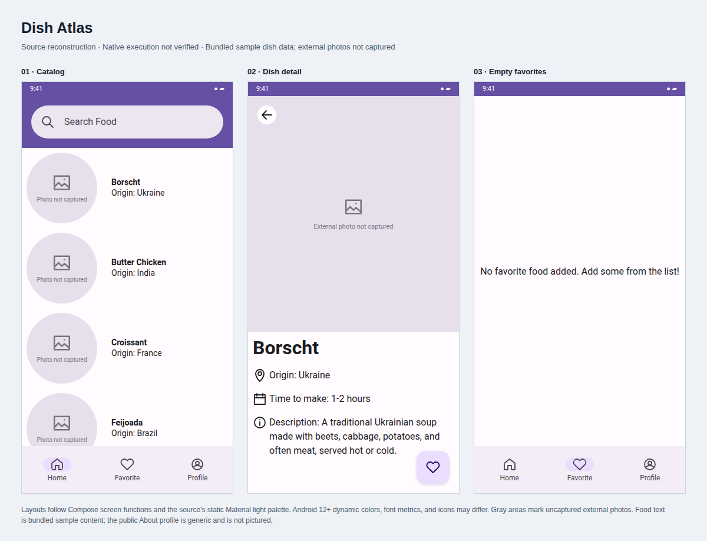
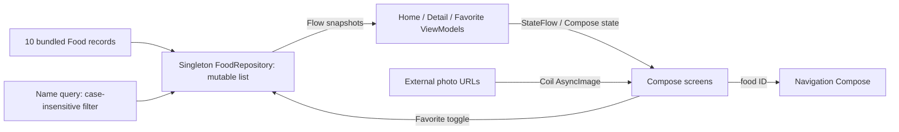

# Dish Atlas

A Kotlin/Jetpack Compose catalog of ten dishes from different countries. Browse
the list, filter by name, open a dish's description, origin, and preparation-time
estimate, or mark it as a favorite. This is a personal Dicoding course submission.

## Interface



Source-based reconstructions, not device screenshots. Dish text comes from the
bundled sample catalog. Gray image areas mark uncaptured external photos.
The visual uses the source's static light palette; Android 12+ dynamic colors
can differ. [Inspect the editable visual](docs/ui-preview.html).

## Mechanism



Search updates on each query change and sorts matching names. Favorites live in
the shared in-memory repository, survive navigation, and reset when the process
restarts. Detail navigation passes an ID; the detail screen hides the bottom bar.
A scroll-to-top control appears after leaving the first list item.

## Run locally

Use Android SDK 34, JDK 17, and the checked-in Gradle 8.6 wrapper.

```sh
./gradlew assembleDebug
# Install app/build/outputs/apk/debug/app-debug.apk on Android 8.0+
```

Android Studio can run the app and its instrumentation suite.
`./gradlew connectedDebugAndroidTest` requires a connected device or emulator.
The source includes navigation and individual screen tests; documentation rendering
does not execute them.

## Provenance and limits

Fourteen app-related commits were retained from a larger private course workspace.
Paths and commit hashes changed during extraction; author names, dates, and
messages were preserved, with a GitHub noreply email. IDE/build files were excluded.
The public About screen uses a generic profile in every retained revision.

Food records are sample content, not a recipe service or user data. Favorites have
no database persistence, and external photo availability was not verified.
Course-derived scaffolding and third-party dependencies remain credited by their
source context. The native build attempt timed out after 180 seconds before task
results; no APK, device execution, or instrumentation results were verified.
